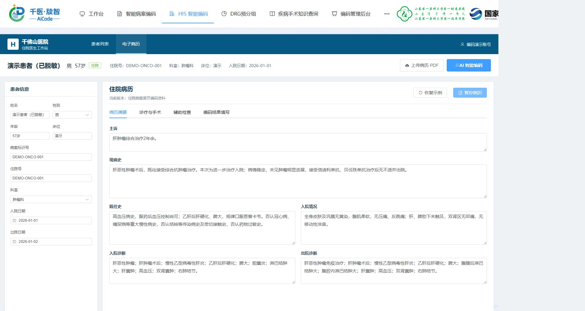
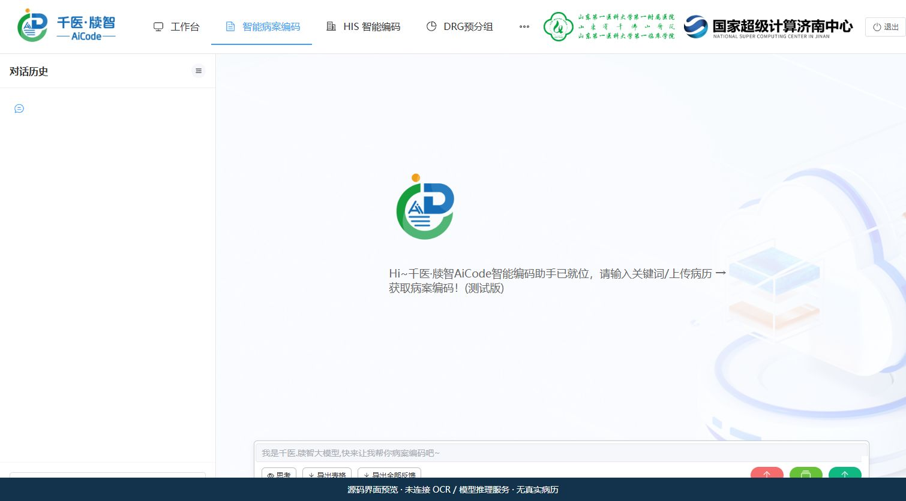
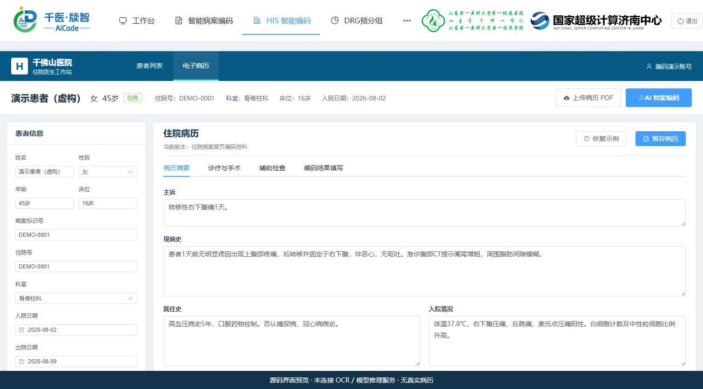
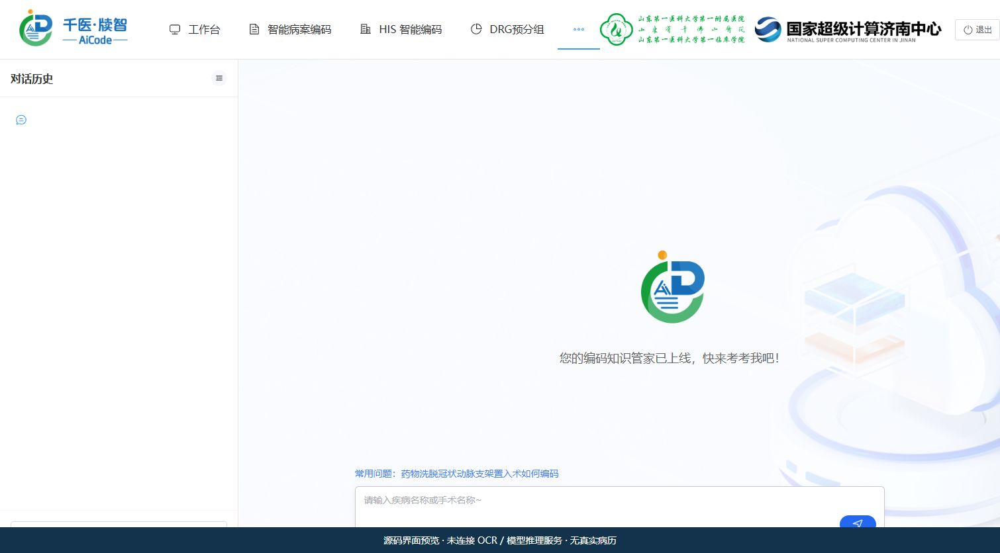
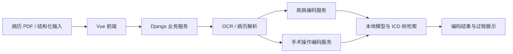

# 智能编码

从病历导入、OCR 与结构化解析，到疾病 / 手术操作编码、ICD 知识查询与编码记录管理的本地大模型工程。

**Vue 3 / Element Plus · Django · Flask · PaddleOCR · 本地 LLM · Elasticsearch**

[功能与界面](#功能与界面) · [界面预览与演示](docs/demo.md) · [部署说明](docs/deployment.md) · [模型与复现资源](docs/models.md)

**[网页演示](docs/media/website-demo.webm)**：工作台 → 暂存患者列表 → 脱敏病例摘要 → 诊疗信息 → 辅助检查 → 编码填写入口。短片由实际网页操作后的六张截图组成；病例为获授权的脱敏临床摘要，身份与日期使用演示值，手工录入，未调用 OCR / 模型推理，尚未生成编码结果。
[本地源码布局预览](docs/media/ui-preview.webm)。

## 功能与界面

| 功能 | 工程内容 |
| --- | --- |
| 病历导入与解析 | PDF / 结构化病历入口、OCR 与文本处理 |
| 疾病智能编码 | 多阶段疾病处理、病理与外因相关模型、ICD 检索 |
| 手术 / 操作编码 | 无手术筛查、手术名称处理、多阶段编码服务 |
| 编码过程查看 | 前端智能体调用状态与结果展示入口 |
| 业务管理 | 对话历史、编码历史、用户权限及管理页面 |
| 知识查询 | 疾病 / 手术编码知识查询页面 |

截图用于说明布局和操作入口。

### 工作台

### 智能病案编码

### 病历导入与结构化入口

### 疾病手术知识查询

## 运行流程

## 模型下载

[模型清单](docs/model-manifest.json)。

详见 [模型资源页](docs/models.md)。

1. 按 [部署说明](docs/deployment.md) 准备 Linux / GPU 和依赖环境。
2. 按 [模型与复现资源](docs/models.md) 准备推理资源、部署目录和检索服务。
3. 配置 `.env.example`，初始化新的业务数据库和账号，检查启动脚本及 GPU 分配。
4. 使用虚构病例验证 OCR、疾病 / 手术编码和结果展示。

患者病历、业务数据库、训练数据、真实凭据与历史 Git 数据不随仓库发布。

## 工程结构

| 路径 | 内容 |
| --- | --- |
| `3090/front-back/qy_icd/qianyi-web` | Vue 3 前端 |
| `3090/front-back/qy_icd/qy_backend` | Django 业务服务 |
| `3090/_LLM/ICD_backend/ICD` | 疾病编码 Flask 服务 |
| `4090/_LLM/ICD_backend/main` | 手术 / 操作编码 Flask 服务 |
| `4090/OCR/PaddleOCR-main` | OCR 源码与适配 |
| `3090/run`、`4090/run` | 模型与服务启动脚本 |
| `environment` | 原 Linux 环境的依赖版本记录 |

## 演示视频与验证状态

详见 [演示素材](docs/demo.md)。

原项目说明见 [原根目录 README](docs/original-root-README.md)。
