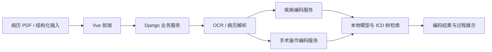

# 千医 · ICD 智能病案编码

从病历导入、OCR 与结构化解析，到疾病 / 手术操作编码、ICD 知识查询与编码记录管理的本地大模型工程。

**Vue 3 / Element Plus · Django · Flask · PaddleOCR · 本地 LLM · Elasticsearch**

[功能与界面](#功能与界面) · [界面预览与演示](docs/demo.md) · [部署说明](docs/deployment.md) · [模型与复现资源](docs/models.md)

**[观看 20 秒界面浏览短片](docs/media/ui-preview.webm)**：由四张静态截图组成，未连接 OCR / 模型服务；正式操作与推理录像待服务可用后录制。

## 功能与界面

| 功能 | 工程内容 |
| --- | --- |
| 病历导入与解析 | PDF / 结构化病历入口、OCR 与文本处理 |
| 疾病智能编码 | 多阶段疾病处理、病理与外因相关模型、ICD 检索 |
| 手术 / 操作编码 | 无手术筛查、手术名称处理、多阶段编码服务 |
| 编码过程查看 | 前端智能体调用状态与结果展示入口 |
| 业务管理 | 对话历史、编码历史、用户权限及管理页面 |
| 知识查询 | 疾病 / 手术编码知识查询页面 |

以下为原 Vue 源码在本机隔离环境中的界面预览：**未连接 OCR、模型推理或真实业务数据库**。截图用于说明布局和操作入口，不代表已运行完整编码流程。

### 工作台

### 智能病案编码

### 病历导入与结构化入口

### 疾病手术知识查询

## 运行流程

## 复现与模型下载

源码与权重分开管理。已整理 **12 个模型、约 46.76 GiB 的推理文件**，逐文件大小与 SHA256 见 [模型清单](docs/model-manifest.json)。

**模型托管平台：ModelScope 魔搭；5/12 个模型已上传并通过大小、SHA256 及固定版本校验。** 其余模型继续上传。仓库均为私有，下载需要账号授权。详见 [模型资源页](docs/models.md)。尚未完成独立 GPU 环境端到端复现。 部署还需 OCR 模型、ICD 字典 / 规则与检索数据，不能只下载 LLM 权重。

1. 按 [部署说明](docs/deployment.md) 准备 Linux / GPU 和依赖环境。
2. 按 [模型与复现资源](docs/models.md) 准备推理资源、部署目录和检索服务。
3. 配置 `.env.example`，初始化新的业务数据库和账号，检查启动脚本及 GPU 分配。
4. 使用虚构病例验证 OCR、疾病 / 手术编码和结果展示。

患者病历、业务数据库、训练数据、真实凭据与历史 Git 数据不随仓库发布。

## 工程结构

| 路径 | 内容 |
| --- | --- |
| `3090/front-back/qy_icd/qianyi-web` | Vue 3 前端 |
| `3090/front-back/qy_icd/qy_backend` | Django 业务服务 |
| `3090/_LLM/ICD_backend/ICD` | 疾病编码 Flask 服务 |
| `4090/_LLM/ICD_backend/main` | 手术 / 操作编码 Flask 服务 |
| `4090/OCR/PaddleOCR-main` | OCR 源码与适配 |
| `3090/run`、`4090/run` | 模型与服务启动脚本 |
| `environment` | 原 Linux 环境的依赖版本记录 |

## 演示视频与验证状态

页面浏览预览可以帮助理解功能入口；包含实际推理结果的正式演示需在服务恢复后使用虚构病例录制。[演示脚本与素材说明](docs/demo.md)已给出 60–90 秒录像顺序。

上传前已做源码语法、JSON、静态凭据及文件范围检查。前端源码已通过 Vite 生产构建；截图验证了页面展示。真实 OCR、模型编码和独立部署效果仍需实测。

原项目说明见 [原根目录 README](docs/original-root-README.md)。第三方授权说明保留在对应子目录，例如 PaddleOCR 的 `LICENSE`。
