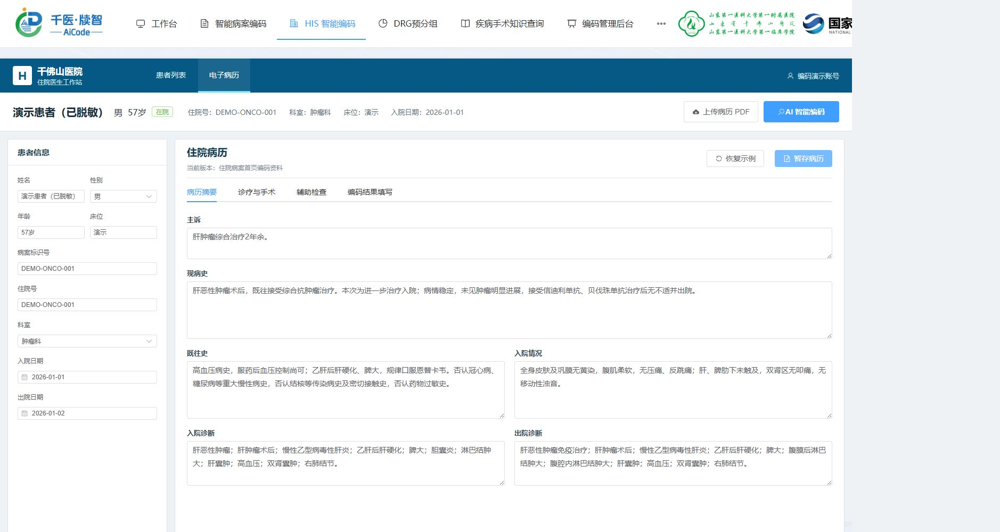
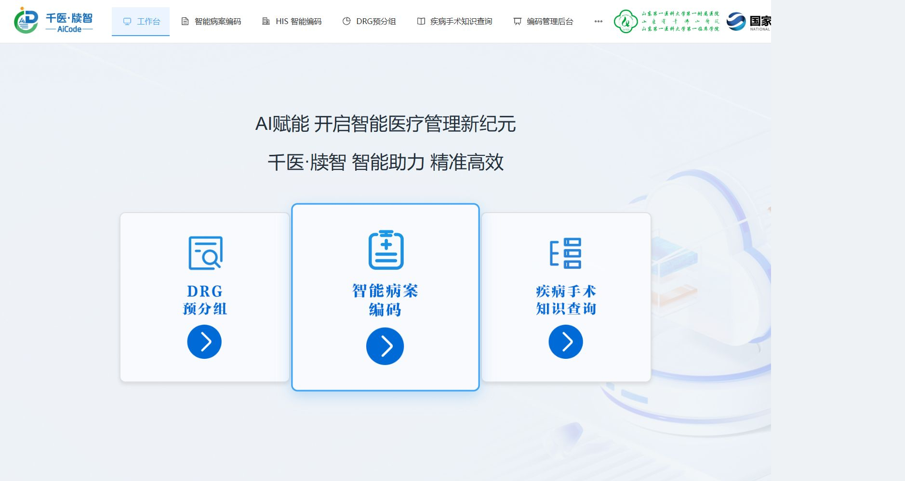
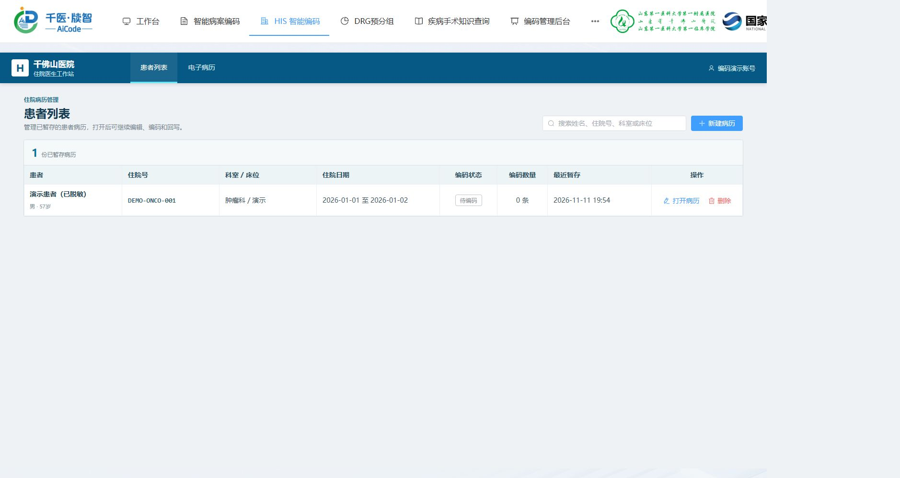
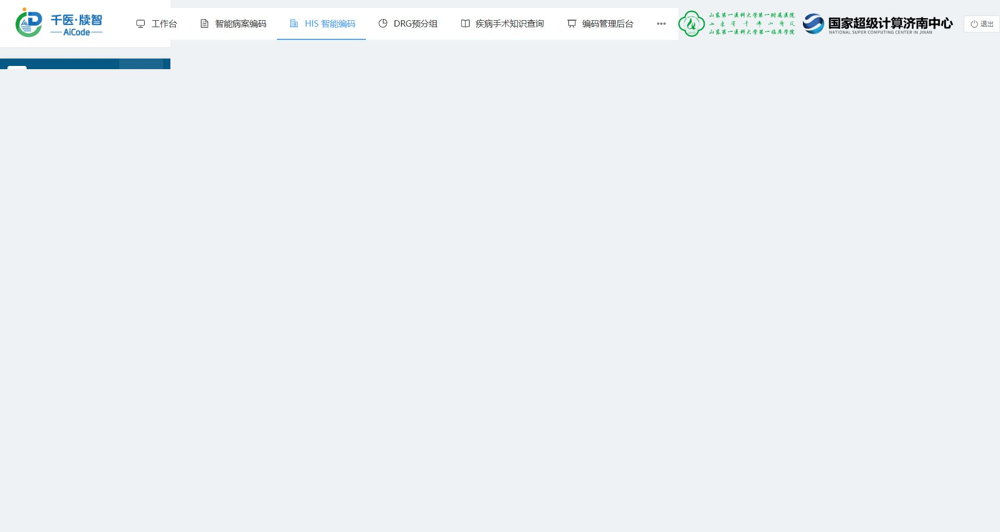
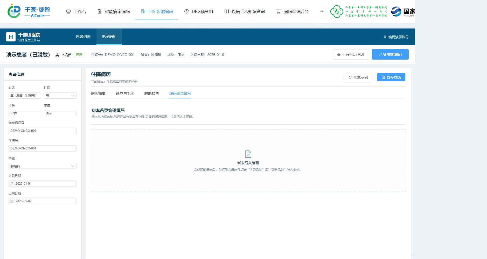

# 实际网页演示

**[观看 36 秒实际网页截图回放](media/website-demo.webm)**。六个步骤各约 6 秒；这是实际页面截图组成的导览，未包含连续操作录屏、OCR 解析或模型推理。

## 展示内容

| 步骤 | 页面与已验证行为 |
| --- | --- |
| 1 | 工作台与功能入口 |
| 2 | 患者列表：一条已暂存的脱敏演示病例 |
| 3 | 病历摘要：手工录入临床摘要及演示身份 |
| 4 | 诊疗与手术：抗肿瘤治疗经过，本次未填写手术 |
| 5 | 辅助检查：手工录入检查摘要 |
| 6 | 编码结果填写入口：当前无编码结果，未执行 AI 编码 |

前端与 Django 业务后端已恢复并验证登录。病例已暂存，能够从患者列表重新打开；这不代表服务端病例数据库持久化已验证。部署地址属于内部网络，公众访问本仓库的媒体即可查看演示。

## 素材与隐私

病例使用方已确认取得用于公开 GitHub 演示视频的授权。演示只采用脱敏临床摘要；姓名、住院号、床位和日期使用演示值，未公开原始病历 PDF、签名、真实身份标识或登录凭据。摘要为人工录入，并非 OCR 输出；结果页保持空白，未伪造模型编码结果。

## 实际页面截图

### 工作台

### 患者列表

### 病例摘要

### 诊疗与手术

### 辅助检查

### 编码结果填写入口

## 其他预览与后续验证

[20 秒本地源码布局预览](media/ui-preview.webm)来自独立本机预览，使用空响应，与本页的实际部署截图区分。

完整推理演示需要在模型服务可用、资源安排合适时，另行验证 OCR → 疾病 / 手术编码 → 结果查看。当前演示未启动模型服务或占用训练 GPU，不包含编码准确率结论。
